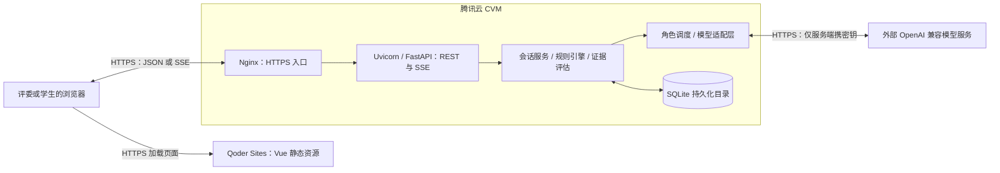

# ScamSense（拆招）架构设计 v1.1

日期：2026-11-19 ｜ 读者：参赛团队的剧情、前端、后端与测试成员 ｜ 状态：目标架构设计稿，未部署。

> **版本说明：** 本文保留设计阶段的记录；下文的空目录、未实现契约及 P0–P5 均指设计时点。仓库现有 v0.1 本地规则演示，实际支持范围和运行方法见[项目首页](../README.md)。

**一句话介绍：** 第一次找实习或工作的学生，在不交出真实个人资料的前提下，和三位虚构角色交流，练习核实招聘信息；训练结束后，可以看到自己的哪些提问、证据和决定影响了评估。

当前工作区原为空，本版从零建立。除本设计文档外，仅预留工程目录；没有可运行的应用、已冻结的 API、数据库或公开站点。本文的“草案”供开发前评审；`TODO` 是需要团队补齐或验证的事项。剧情原稿未提供，不为 E01–E16 编造事件。

## 1. 参赛规则如何影响交付

来源：[阿里云天池 · 2026 Qoder 高校创造力大赛官方赛题页](https://tianchi.aliyun.com/competition/entrance/532536)，于 2026-11-19 核对“关于大赛”“赛道方向”“赛事流程”“作品要求”“参赛步骤”正文。若有更新，以主办方公告为准。

| 官方规则 | 拆招团队要做什么 |
|---|---|
| 全国在校大学生（含港澳台、本专科及硕博，不限专业），1–3 人组队。全体成员须在初赛截止前完成天池实名认证和阿里云大学生认证，否则取消获奖资格。 | 由每位成员在官方渠道核对；不把认证材料放进工程或作品帖。 |
| StudyHack 学习科研、LifeHack 生活娱乐、Hack4Good 技术向善，任选其一，分别评分设奖。 | **建议 Hack4Good 技术向善**：目标人群是缺少求职经验的学生，演示重点是其能否主动核实，而不是展示聊天模型能说多少话。尚未代为报名。 |
| 报名组队、发布作品均为 **2026-10-29 至 2026-11-30 18:00**（赛题页所示时间）；初筛 12/1–12/7，每赛道 14 队；决赛及奖项公布 12/1–12/15，线上直播路演。 | 11/30 18:00 **前**完成组队和赛题页论坛发帖；12/15 不是作品截止日。 |
| 规定时间内用 Qoder 完成原创作品的开发与部署，遵守社区规范与法律法规。作品用 **Qoder Sites 部署并设为公开访问**；原则上不接受本地文件或压缩包，特殊情况联系官方运营。 | 留存真实的 Qoder 开发、人工修订与发布记录。用无登录状态的浏览器，从帖子链接完整走通训练；仅首页能打开不算团队验收通过。 |
| 天池赛题页论坛作品帖：公开作品链接 + 五项介绍：自我介绍、作品是什么、为什么做、怎么用（**5 步以内**）、用 Qoder 做出来的过程。建议多用截图。社媒分享链接可选，分享标题须带“2026 Qoder 高校创造力大赛”。 | 截图用虚构资料并遮盖账号隐私、密钥。不把社媒分享、视频、代码仓库或截图数量误列为合格提交的硬门槛。 |

**规则与团队方案的边界：** 团队表示当前使用 Qoder Free，按“Sites 仅承载静态前端”设计；这不是对所有账号权益的断言。官网要求开发与部署均由 Qoder 完成，未在上述正文单独说明“Sites 前端 + 外部业务后端”的合规性。**TODO（最好在编码前）：** 向赛事运营确认腾讯云 CVM 提供 API 的方案，保留答复；未经确认不宣称已符合参赛要求，也不擅自改成把后端部署到 Sites。

**拟给评委的 5 步体验（不是已上线功能）：** ① 打开公开链接并进入虚构训练；② 在同一界面切换角色，了解岗位；③ 就疑点追问、索要依据或交叉核实；④ 提交自己的决定和理由，也可提前结束；⑤ 打开复盘，从分项说明跳回对应消息。

## 2. 场景、角色与信息边界

拆招不是招聘平台，不接受简历投递，不接入真实招聘方，不验证真实身份，也不替用户鉴定现实中的某家公司。MVP 只做一场可从头到尾体验的训练。场景可配置一个或多个风险角色，不能让界面或评分器假设“总有且只有一个坏人”。

| 角色（设计侧身份） | 可以知道、可以表达 | 边界 |
|---|---|---|
| 林悦：正规 HR | 了解自己所在虚构企业的岗位与正规流程，作为对照；交流简洁务实，也可以忙碌。 | 不知道陈浩的隐藏动机，不替其他角色背书或主动揭底。 |
| 陈浩：隐藏风险 HR | 自称科技公司招聘顾问。岗位和待遇有现实合理性；剧情可逐步涉及候选人预登记。风险集中于招聘主体、受托关系、资料范围、用途、保存期限及接收方能否说清。 | 不能凭空增加剧情事实或证件要求；疑点必须可被核实。只使用虚构占位资料，不索要真实证件、账号、住址或转账。 |
| 王宇：大学朋友 | 在校园群见过类似消息，有求职焦虑，可能表达有限的正面印象；被追问时承认没有亲自核实。 | 群消息不是独立证据；不是同谋，不编造“朋友已成功入职”等案例。 |

**同屏不等于群聊。** 每次请求只选择一个 `role_id`。后端分别维护三份 Prompt；上下文由「该角色卡 + 对该角色开放的场景事实 + 当前阶段允许披露的内容 + 本会话与该角色的历史」构成。历史必须同时按 `session_id`、`role_id` 过滤；摘要如有也不能跨角色共享。角色无数据库写权限、不持有工具、不接收其他私聊、评分或完整剧本。用户自己转述的话只是用户陈述，不会自动成为已核实事实。前端仅接收可见姓名与公开简介，不下载隐藏身份、规则表或 Prompt；复盘服务才按本场权限跨对话引用证据。

## 3. 总体架构与技术选择



| 层 | 已选技术与职责 |
|---|---|
| 浏览器 | Vue 3、TypeScript、Vite、Element Plus、Vue Router、Pinia。页面分为进入训练、三路私聊/决策、复盘。Pinia 管理当前角色、消息流与加载状态，不计算权威阶段或分数。 |
| 应用 | Python、FastAPI、Pydantic、Uvicorn；单体内分模块。Nginx 做 HTTPS 与反向代理，systemd 管理进程。浏览器直接调用腾讯云 HTTPS API；不依赖 Sites 转发 SSE。 |
| 数据 | SQLAlchemy 2.x、SQLite、Alembic。数据库在 CVM 独立持久化目录，迁移随发布版本管理。 |
| AI 与测试 | 后端统一适配 OpenAI 兼容 API；角色生成、结构化意图与确定性规则分开。后端使用 Pytest，以可控模型替身做集成测试，不要求每次测试消耗模型额度。 |

MVP 不引入 Redis、微服务、消息队列、向量数据库或 LangGraph。一个进程可以编排三位角色；隔离的是输入和写权限，不是服务器台数。

## 4. 剧情状态机：固定事实，动态触发

固定风险，灵活表达。**规则引擎更新状态，LLM 生成语言**。阶段是对场景进度的描述，不是轮数、倒计时或必须走完的关卡。

| 阶段 | 场景含义 | 进入或停留条件（草案） |
|---|---|---|
| S0 初始接触 | 建立训练，看到公开角色 | 创建成功后进入；尚无依据时不前进。 |
| S1 了解机会 | 讨论岗位、公司或流程 | 相应意图和场景前置条件均满足。 |
| S2 候选人预登记 | 讨论虚构候选人预登记 | 仅在剧情定义允许时进入；不要求填写真实表单。 |
| S3 信息风险线索 | 有机会发现主体或资料范围等疑点 | 授权披露不等于回复已发出，更不等于用户已经识别。 |
| S4 主动核实 | 向角色要求来源、证据或解释 | S0–S3 均允许提前核实；资料尚未开放时仍记录行动，不捏造答复。不为“补课”倒退阶段。 |
| S5 最终决策 | 对继续、拒绝、暂缓、进一步核实作决定 | 任一 S0–S4 可由明确的决策操作到达；聊天中的猜测不等于提交。 |
| S6 训练复盘 | 结束交互，读取报告 | 已确认的决策，或用户明确提前结束；终态不可继续发消息。 |

**转移契约（待 P2 冻结）**

- 输入：会话版本、当前阶段、用户消息或确认操作、结构化意图、已发生事件、已披露线索和剧情规则版本。输出：保持/转移、原因、允许向当前角色披露的事实、待记行为、事件引用。不接受模型声称的“新阶段/新分数”。
- 普通路径为 S0→S1→S2→S3→S4→S5→S6；前进必须命中已审核规则。允许前表中的提前核实和跨阶段决策。直接提交可以在同一事务记录“原阶段→S5→S6”，不补造跳过的事件。任一活动阶段也可经确认直接结束至 S6，无须捏造最终选择。
- 聊天中“我再想想”可以停留；在决策表单明确选择“暂缓”或“进一步核实”并确认，则结束本次训练。未确认、意图含糊、闲聊或只增加轮数不触发高影响变更。未命中规则保持原状；过期版本、终态写入与非法转移拒绝，不产生重复行为或得分。
- 意图草案：`ask_job`、`verify_source`、`question_data_scope`、`identify_risk`、`express_choice`、`other`。返回 `[{type, confidence, evidence_span, parameters}]`，由 Pydantic 校验；文本片段须来自本条去敏消息。多意图先去重，仅独立记录有证据的行为；互斥、低置信度或结构异常则澄清或保持原阶段。阈值、冲突优先级和标注样本 **TODO**，不靠阈值替代用户确认。
- 用户输入落库、行为去重、规则转移和事件日志在一个短事务内提交；会话版本做条件更新。每个会话同时最多一个生成中的回复，切角色不另开写通道。模型网络调用在事务外；过期或重放的结果不得覆盖终态。
- **保留的剧情事件编号：E01–E16。** 定义接口为 `code, scenario_version, allowed_phases, prerequisites, trigger_intents, visible_to_roles, allowed_fact_ids, clue_ids, effect, repeat_policy`；运行日志另记会话、来源、前后阶段、规则版本、发生时间及幂等键。**TODO：** 由剧情负责人交付 16 条原始定义、角色可见矩阵及线索清单后映射；本版不分配事件名称、触发点或台词。

**行为判定示例（不对应任何事件编号）：** 用户刚开场就问王宇“这件事你亲自核实过吗？”。系统可凭这条消息记录一次主动核实。它不能据此断定陈浩的身份，不能把问题转发给林悦，也不能仅因提出了问题就判定用户已识别全部风险。

## 5. 后端模块与写入边界

| 模块 | 输入 → 输出；谁可以写什么 |
|---|---|
| 会话管理 | 创建、读取、结束、校验访问凭证和版本；持有生命周期，拒绝终态写入。 |
| 消息管理 | 接收去敏消息、按角色读历史、管理一次生成和 SSE；保存回复、完成/中断状态。 |
| 角色调度 | 从角色 ID、阶段和规则许可构造单角色上下文；仅产出可展示的自然语言，不改规则、事实或报告。 |
| 意图识别 | 自由文本 → 有原文依据的候选意图；不直接写状态，不启动转账、收集资料等外部操作。 |
| 状态机 / 规则引擎 | 结合意图、事实和显式操作裁决，产生阶段变更、待披露事实与带原因的事件。独占剧情状态写入口。 |
| 线索管理 | 区分“允许说”“合规消息已发出”“界面已呈现”“用户已指出”；引用对应消息或行为。 |
| 行为记录 | 将核实、提问、指出风险、作出选择等归一化；保留当时阶段、证据、去重依据。 |
| 评估报告 | 终态后从冻结的行为与证据计算分项和总分，生成建议；报告不反写历史。 |
| 模型适配 | 封装 OpenAI 兼容服务的超时、限流、错误映射、文本输出过滤与结构校验；不向浏览器暴露凭据或供应商原始错误。 |

## 6. 数据模型与评估证据

以下七个实体均需持久化；ID 为不透明标识，时间统一 UTC，展示再换算本地时区。剧情定义与角色卡由后端按版本加载；模型原始请求、完整 Prompt、未过滤输入和浏览器缓冲不入库。

| 实体 | 关键字段与约束 |
|---|---|
| `TrainingSession` | `id, scenario_version, phase(S0–S6), status(active/completed/ended_early), version, token_digest, created_at, ended_at, expires_at`。终态必须有结束时间，阶段为 S6；只保存匿名会话凭证摘要。 |
| `Message` | `id, session_id, role_id, sender(user/role), client_message_id, reply_to_id, content, status(pending/complete/interrupted/failed), created_at, meta`。私聊双方的消息都带同一角色 ID。用户请求在会话内唯一；回复引用其输入，只存去敏内容与白名单元数据。 |
| `ScenarioEvent` | `id, session_id, code, kind, rule_version, condition_ref, source_id, from_phase, to_phase, occurred_at, event_key`。`code` 在剧情触发时引用 E01–E16，生命周期事件不冒充剧情事件；`(session_id,event_key)` 唯一。 |
| `SessionClue` | `(session_id,clue_id)` 唯一；`disclosed_at, disclosure_message_id, presented_at, recognized_at, recognition_behavior_id` 分开、可空。主动预判可先于正式披露；不反填虚构的披露时间。 |
| `BehaviorRecord` | `id, session_id, type, phase_at_action, message_id或decision_id, clue_id?, evidence_span, occurred_at, dedup_key`。证据锚点限定在同会话；同一操作重放不新增记录。 |
| `FinalDecision` | `id, session_id(唯一), choice(continue/decline/defer/verify_more), reason?, submitted_at, request_id`。仅显式确认后写入；无选择的提前结束可以没有此行。 |
| `EvaluationReport` | `id, session_id(唯一), rubric_version, dimension_scores, total?, evidence_refs, strengths, suggestions, created_at`。引用行为与原消息 ID，保存评分快照；重复读取不重新打分。 |

关系：会话 1:N 消息、事件、会话线索及行为；会话 1:0..1 最终决定、1:0..1 报告。启用 SQLite 外键；禁止跨会话证据引用。消息按 `(session_id,role_id,created_at,id)` 稳定分页。会话到期整体清理依赖数据，不保留可还原对话的孤立报告。

**从展示到评分要跨三道证据门槛。** 合规回复成功保存，服务端才记“披露”；前端展示完整消息并回执后才记“已呈现”（不证明用户理解）。用户用自己的话指出疑点才记“识别”；要求对方提供来源、授权依据等才记“核实”。中途断流、没有展示回执或没有提供观察机会，不能当作“看到了却没发现”。

| 训练维度 | 权重 | 可采信的证据 |
|---|---:|---|
| 风险识别 | 25% | 用户指出具体矛盾或超范围要求的原消息，以及对应事实；不是看到回复就得分。 |
| 主动核实 | 30% | 主动询问招聘关系、消息来源或要求凭据的行为；同一问题重放不重复得分。 |
| 决策合理性 | 25% | 最终决定及理由是否与当时可获得的证据相称；拒绝不自动满分，继续也不自动零分。 |
| 证据分析 | 20% | 是否区分群聊转述和亲自核实，是否对照不同信息来源并说明证据局限。 |

四项分数采用 0–100 同尺度；可评估时 `总分 = 风险识别×0.25 + 主动核实×0.30 + 决策合理性×0.25 + 证据分析×0.20`。草案：没有观察机会的维度显示“证据不足”，总分留空，不硬填 0 或自行重分配权重；能评价的维度仍附依据。**TODO：** 冻结等级量表、最低证据门槛、重复行为与总分取整规则。复盘每项按“判断 → 行为 ID → 消息/决策 ID → 去敏原文”展示，并给一条可执行建议。模型可润色说明，但不能决定分数或新增证据。这些权重是**训练规则，不是比赛评审权重**。

## 7. REST / SSE 契约草案（待 P4 冻结，均未实现）

版本前缀 `/api/v1`，下表除 `/healthz` 外均相对此前缀。JSON 使用 UTF-8。匿名用户创建会话后只获取本场的高熵 `session_token`；会话级请求使用 `Authorization: Bearer <session_token>`，不使用 Cookie 或 URL 携带凭证。前端只在本标签页的 `sessionStorage` 中保存会话 ID 和短期凭证，以支持刷新；不缓存聊天原文。服务端校验有效期、归属和角色；公开的是体验入口，不是历史记录。

MVP 在提交决定或提前结束时，用同一个短事务写入终态、证据索引与确定性报告，不等待模型生成评语；提交失败可用原请求键重试。终态成功响应即 `report_ready:true`。报告里的 `evidence_refs` 包含本场 `role_id`、`message_id` 或 `decision_id`、关联 `behavior_id` 及去敏摘录，前端据此定位对应私聊或决策。

| 方法 / 路径 | 请求要点 | 成功响应 / 状态语义 |
|---|---|---|
| `GET /healthz`（无前缀） | 不调用模型或泄露配置 | `200 {"status":"ok"}`，仅表示应用可响应；数据库读写另行验收。 |
| `POST /sessions` | `{}`，使用当前已发布的虚构场景；限制创建频率 | `201 {session_id,session_token,phase,status,roles,expires_at}`；返回公开角色信息。 |
| `GET /sessions/{sid}` | 本场凭证 | `200 {session_id,phase,status,version,roles,decision?,report_ready}`；不含后台线索表。 |
| `GET /sessions/{sid}/roles/{rid}/messages` | `cursor?,limit?`，限定本场与单个角色 | `200 {items:[{id,sender,content,status,created_at}],next_cursor}`。 |
| `POST /sessions/{sid}/roles/{rid}/messages` | `{client_message_id,text}`；`Accept: text/event-stream` | `200` SSE；只生成被选择角色的回复，处理方式见下。 |
| `POST /sessions/{sid}/messages/{mid}/seen` | 界面实际呈现完整消息后回执 | `204`，可重放；不会因此给识别分。 |
| `POST /sessions/{sid}/decision` | `{request_id,expected_version,choice,reason?}`，用户明确确认 | `200 {phase,status,decision_id,report_ready}`，保存决定、记录事件、结束。 |
| `POST /sessions/{sid}/end` | `{request_id,expected_version}`，明确提前结束 | `200 {phase,status,report_ready}`；无最终决定也能复盘。 |
| `GET /sessions/{sid}/report` | 限本场所有者 | `200 {dimensions,total,evidence_refs,strengths,suggestions}`；训练中请求返回 `409 report_not_ready`。 |

写请求凭 `client_message_id` 或 `request_id` 幂等：同会话同键同载荷返回原结果；同键异载荷 `409 idempotency_conflict`；正在生成时重复提交或跨标签页抢写 `409 turn_in_progress`，客户端刷新状态。决策与结束时先查幂等记录，再校验版本。流开始前的错误使用 `{error:{code,message,request_id}}`；缺失/无效凭证 `401`，不存在或不属于本场的子资源 `404`，非法状态 `409`，字段不合法或检测到敏感输入 `422`，超限 `429`，依赖不可用 `503`。不向客户端回显原文、内部堆栈或供应商错误体。

### 流式回复与掉线

使用浏览器 `fetch(POST)` + `ReadableStream` 解析 SSE；原生 `EventSource` 不支持这种带 JSON 请求体的 POST。响应头 `Content-Type: text/event-stream; charset=utf-8`、`Cache-Control: no-cache, no-store`、`X-Accel-Buffering: no`。UTF-8 增量解码，按空行拆帧，不把一次网络读取当成一个事件。示意帧（ID 与文本仅用于说明协议）：

```text
id: turn-1:1
event: start
data: {"turn_id":"turn-1","message_id":"m2","role_id":"r1"}

id: turn-1:2
event: delta
data: {"message_id":"m2","text":"可以，先说说你想核实的部分。"}

id: turn-1:3
event: complete
data: {"message_id":"m2","status":"complete","session_version":3}

```

- 首次接收消息：鉴权、隐私校验、记录用户行为后释放数据库写锁；模型仅收到获准上下文。按短句等安全边界校验后发送 `delta`，不将未校验的供应商 token 原样外发。最后一个短事务保存角色回复和实际披露的线索，成功后才发 `complete`。
- 模型超时、429、无效结构或违规输出时，不推进未满足条件的剧情。只在尚未输出且总时限允许时对暂时性错误有限重试；一旦发出 `delta` 不自动重试。流内错误以 `event: error`、`data: {"message_id":"m2","code":"model_timeout","retryable":true}` 并以空行结束；`error` 与 `complete` 互斥，不能中途改 HTTP 状态码。
- 切换角色或网络断开：客户端按 `message_id` 绑定气泡，取消读流后不把片段投到另一私聊。服务端尽力取消上游调用，未完成消息记 `interrupted` 或 `failed`；保留已提交的用户行为，不据残片判定已披露。若服务器已提交 `complete` 而客户端错过最后一帧，以历史为准。进程重启时把失去执行者的 `pending` 收敛为中断。
- 重连先读会话和历史，不自动重发用户消息；已完成的同键请求可用 `start`/`complete` 指向原结果，客户端取原消息全文。失败重放返回已知失败，不再次收费调用；显式重试要关联原行为去重，具体字段 **TODO（P4）**。MVP 不承诺逐 token 断点续传。
- Nginx 的 SSE 路径配置 `proxy_http_version 1.1`、`proxy_buffering off`、`proxy_cache off`、`gzip off`。建议每 15 秒发 `: ping` 注释心跳，模型总时限先按 60 秒、`proxy_read_timeout` 先按 90 秒联调；上线前实测首段时间、空闲间隔与超时值。SSE 是单向响应流，不是 WebSocket。

## 8. 安全、隐私与公开演示

1. 进入和输入处说明：这是模拟训练，只能使用“候选人甲”等虚构资料。检测到疑似身份证号、银行卡号、真实联系方式或家庭住址时，请用户改写；在落库、日志和模型调用**之前**拦截。无法保证识别所有自由文本，告知外部模型处理范围，提供退出和清理说明。不设真实资料上传入口。
2. CORS 精确列举正式 Sites Origin；开发环境单独允许必要的本机 Origin，生产不带开发白名单、不用 `*`。允许所需 `GET/POST/OPTIONS`、`Authorization/Content-Type` 预检。CORS 不代替会话鉴权。凭证不进 URL 或公开截图；显示模型文本用纯文本或经清理的渲染，不执行 HTML。
3. 限制文本长度、单场消息数、并行生成、匿名开场频率及每日模型预算；预算用尽给可理解的提示，已有历史和报告仍可读取。阈值 **TODO：** 根据演示人数、模型额度与压测冻结。健康检查不消耗模型额度。
4. 只记录请求 ID、错误码、耗时等必要运维信息；不记聊天正文、Prompt、令牌、API Key、真实密码或认证材料。数据库、备份及后端配置限制权限；不把任何角色私聊回放公开分享。
5. 保留期草案：会话及报告自创建起最多 7 天，定时清理到期会话并级联删除证据；备份另有最多 7 天的轮换窗口，告知可能的延迟清除。运维日志独立轮转。**TODO：** 冻结保留期、主动清理渠道、外部模型的数据处理与留存政策；上线前将实际承诺告知用户。

## 9. 开发与生产环境、发布和恢复

| 配置 | 开发 | 生产（没有实际值） |
|---|---|---|
| `VITE_API_BASE_URL`，唯一公开 API 基址 | 例：`http://127.0.0.1:8000/api/v1`；Vue 组件只调统一 API 客户端 | 构建时注入腾讯云后端 HTTPS 基址，或选经验证的公开配置；变更后验证实际网络请求。禁止在任何 `VITE_*` 中放秘密。 |
| `DATABASE_URL`、`CORS_ALLOWED_ORIGINS` | 独立的本地 SQLite 与本机开发 Origin | 独立持久化卷、正式 Sites Origin；真实域名 **TODO**。 |
| `MODEL_BASE_URL`、`MODEL_NAME`、`MODEL_API_KEY` | 仅后端本地 `.env` 或环境变量；自动化测试使用替身 | CVM 后端的环境变量或仅服务账号可读的受保护配置；凭证绝不发给浏览器。供应商、模型、地址 **TODO**。 |
| 工程卫生 | P5 提供前后端各自的 `.env.example`，只写变量和占位值；Vue/Vite 与 FastAPI 在本地独立启动 | `.gitignore` 排除真实 `.env`、密钥、数据库及其 WAL/SHM、备份、日志；仅放行无秘密的示例文件。打包前检查产物与仓库。 |

**生产发布顺序（未来执行）：**

1. 先确认赛事对外接后端的口径。确认 CVM 系统和资源、独立持久目录、域名、证书、防火墙与安全组；API 仅经 HTTPS 对外，Uvicorn 只监听本机或受保护接口。
2. 在 CVM 准备 Python、依赖及受保护环境配置；校验目录权限，先备份，再执行 Alembic 迁移。systemd 管理 Uvicorn、设置异常重启和开机启动；Nginx 设置 TLS、反代、SSE 与访问限制。
3. 前端设置公开 API 基址，用 Vite 生成静态资源，经 Qoder 发布到 Qoder Sites 并设为公开。**TODO：** 当前 Sites 项目的构建命令、产物目录、构建环境变量注入方法、SPA 路由回退及最终域名；不能把本地 Vite 默认值当平台承诺。若不能验证 History 回退，可选 Vue Router hash 模式，再实测复制链接和刷新。
4. 配置精确 CORS 白名单，用公开入口验证健康检查、数据库读写、REST、SSE 和完整复盘；再测服务异常重启、服务器重启和恢复演练。最后按第 1 节发帖，存留开发和部署凭证。此文档不构成已完成部署或提交的证明。

**SQLite 的边界：** 单台 CVM、小规模演示、短写事务；不得在持有写事务时等待模型或发送 SSE。开启外键，评估 WAL 和合理的 `busy_timeout`；并发模拟三路切换与多会话，记录锁等待。若持续写竞争、需要多机共享或恢复指标不达标，再评估 PostgreSQL，不预先引入。

**可执行的备份草案（运维示例，未运行）：** 数据文件放在版本发布目录之外，例如 `/var/lib/scamsense/`；备份用受限独立目录，另留受保护的异盘副本。每日用系统计时器触发 SQLite 在线备份，不直接复制正在写入的数据库主文件。下例要求已创建目标目录、安装 `sqlite3` 命令，并把路径改为真实值：

```sh
set -eu
umask 077
db=/var/lib/scamsense/scamsense.sqlite3
dir=/var/backups/scamsense
test -s "$db"
test -d "$dir"
out="$dir/$(date -u +%Y%m%dT%H%M%SZ).sqlite3"
sqlite3 -readonly "$db" '.timeout 5000' ".backup '$out'"
test "$(sqlite3 -readonly "$out" 'PRAGMA integrity_check;')" = ok
```

建议 systemd timer 每日运行（例如 `OnCalendar=*-*-* 02:15:00 UTC`、`Persistent=true`）；仅在备份成功且校验通过后标记可恢复，失败告警，轮换过期副本。**恢复验收：** 复制最新有效备份到隔离目录，不覆盖在线库；对副本执行 `integrity_check`、`foreign_key_check`，用相同迁移版本启动测试实例，读一场合成训练的历史和报告、再创建一条测试会话，记录恢复耗时。正式切换须另行批准。**TODO：** 实际路径、异盘位置、保留窗口、恢复时间目标和运维负责人。

## 10. 工程目录与阶段边界

以下目录已在工作区预留；除 `docs/architecture.md` 外目前均无实现文件。空目录不会被 Git 单独追踪，本节同时是团队重建目录的依据。

```text
项目根目录/
├── frontend/
│   ├── public/
│   └── src/
│       ├── api/          统一 REST 与 SSE 客户端
│       ├── components/   共用聊天与复盘组件
│       ├── views/        进入训练、会话、报告
│       ├── stores/       Pinia 会话与界面状态
│       ├── router/       页面路由
│       └── types/        客户端可见的契约类型
├── backend/
│   ├── app/
│   │   ├── api/          HTTP / SSE 边界
│   │   ├── core/         配置、鉴权、数据库连接
│   │   ├── models/       SQLAlchemy 持久化实体
│   │   ├── schemas/      Pydantic 输入输出
│   │   ├── services/     会话、消息、调度、意图、证据、报告、模型适配
│   │   ├── state_machine/ 阶段守卫与事件裁决
│   │   └── prompts/      只在服务端使用的分角色模板
│   ├── migrations/       Alembic 迁移
│   └── tests/            Pytest 单元与集成测试
└── docs/
    ├── architecture.md   本文
    ├── scenario/         放经团队确认的剧情输入
    └── api/              放经团队冻结的契约
```

## 11. 验收清单（未来执行，不是本次测试结果）

| 检查 | 可重复的步骤与通过标准 |
|---|---|
| 会话与隔离 | 用 Pytest 建两场会话、各向三位角色发不同标记；通过模型替身捕获输入，当前角色仅收到本场本角色标记。无凭证、其他会话凭证均不能读原场历史或报告。 |
| 规则与自由路径 | 对 S0–S6 做表驱动测试：连续闲聊、低置信度、多意图冲突、模型自称改分均不推动高影响状态；另测开场核实、直接拒绝、暂缓、进一步核实和提前结束，事件只记合法转移。 |
| 线索与评分 | 组合测试“只获准披露”“已呈现未识别”“先主动识别”“要求核实”；报告能回指消息，分开呈现三者。用同一最终选择但不同提问历史的样本验证评分差异，并覆盖提前结束无足够证据的情况。 |
| 幂等与并发 | 重放同一条消息和同一决定；模拟两标签页基于旧版本写入。只生成一次有效动作、一个决定及一份报告，不重复收费调用或计分。 |
| API / SSE | 校验 JSON 契约与 REST 状态码；通过实际 Nginx 用浏览器或 `curl -N` 观察带时间戳的多个 `delta` 在 `complete` 前抵达。模拟超时、上游 429、非法输出、断网及重连，终止事件不重复，片段不进入其他角色。 |
| 隐私与密钥 | 用测试标记模拟敏感输入，断言不落库、不入日志、不发给模型。用无价值的哨兵值代替测试密钥构建前端，检查静态产物、浏览器网络和待公开文件，均不含哨兵或真实密钥。 |
| 公网与 CORS | 无痕窗口从 Sites 公开链接进入，刷新页面并走完五步；请求是 HTTPS，正式 Origin 预检通过，不在白名单的 Origin 不获准跨域读取，无混合内容警告。 |
| 持久化与恢复 | 在获准的测试 CVM 上模拟进程异常退出、整机重启；systemd 恢复服务，迁移版本和历史仍在。按第 9 节从备份在隔离位置恢复并成功读写。 |
| 参赛提交 | 另一位成员按作品帖说明在 5 步内独立拿到可追溯的报告；逐项核对双认证、公开链接、帖子五项和 Qoder 过程证明，再正式发布。 |

## 12. 下一阶段与待确认事项

| 阶段（本次均不启动实现） | 到下一步前要交付的内容 |
|---|---|
| P0 设计输入整理 | **首先取得 E01–E16 原稿**，与角色卡、S0–S6、事实/线索清单和角色可见矩阵一起审核；各选一条“正常走完”“开场核实”“提前结束”路径做桌面推演。 |
| P1 领域数据结构 | 冻结七实体、数据保留、外键、唯一键和报告证据引用；用一条合成训练记录验证能回溯。 |
| P2 状态机契约 | 冻结守卫、跨阶段路径、非法转移、去重和终态行为；审查提前核实与跳过的例子。 |
| P3 意图识别契约 | 冻结意图集合、片段格式、置信度阈值、多意图优先级和澄清规则。 |
| P4 API 契约 | 冻结 REST/SSE 载荷、错误、重连与重试、匿名访问机制、公开基址、评分与展示验收样例。 |
| P5 可运行工程骨架 | 获准后才创建前后端入口、依赖清单、示例环境文件、`.gitignore`、Pytest 和健康检查，补 README；先验证前后端独立启动，再写业务。 |

**现在需要团队确认的 TODO：**

- **参赛负责人：** 选定赛道；确认全员认证、外接后端的赛事口径、发帖负责人及实际公开链接。不要把开发目录当参赛交付物。
- **剧情与评估负责人：** 提供 E01–E16 原文及每项事实的角色权限、触发与可观察证据；批准评分量表、提前结束和证据不足时的报告表现。
- **平台与运维负责人：** 确认腾讯云 OS/版本、CPU、内存、磁盘、持久化与备份位置；域名归属及正式 API 域名、证书申请与续期方式、防火墙/安全组。确认正式 Sites 域名、构建命令、输出目录、环境变量、路由回退与公开访问。
- **模型与隐私负责人：** 确认服务商、模型、API 地址、可用额度、超时/限流策略、数据处理政策及演示数据清理周期。以上均不需要把真实密钥交到设计文档中。
